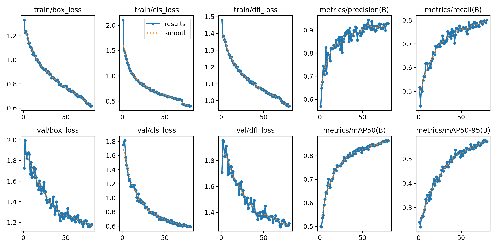
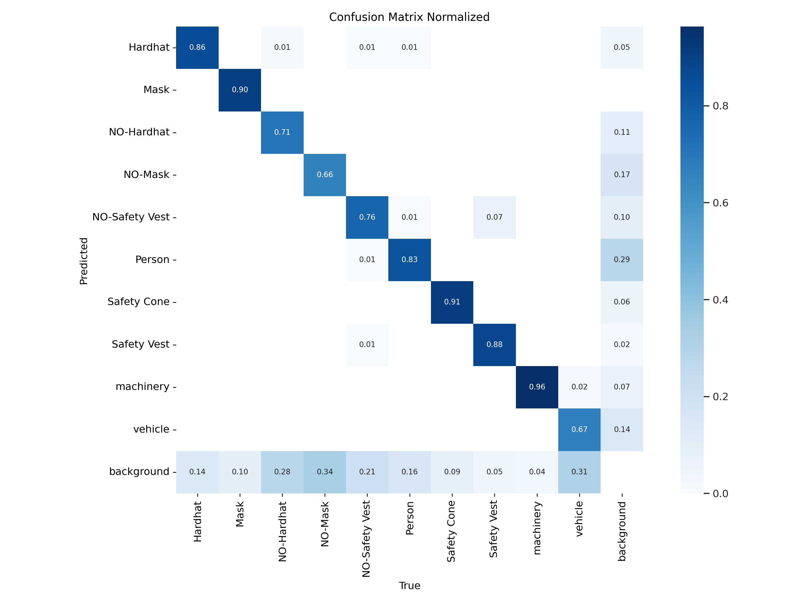
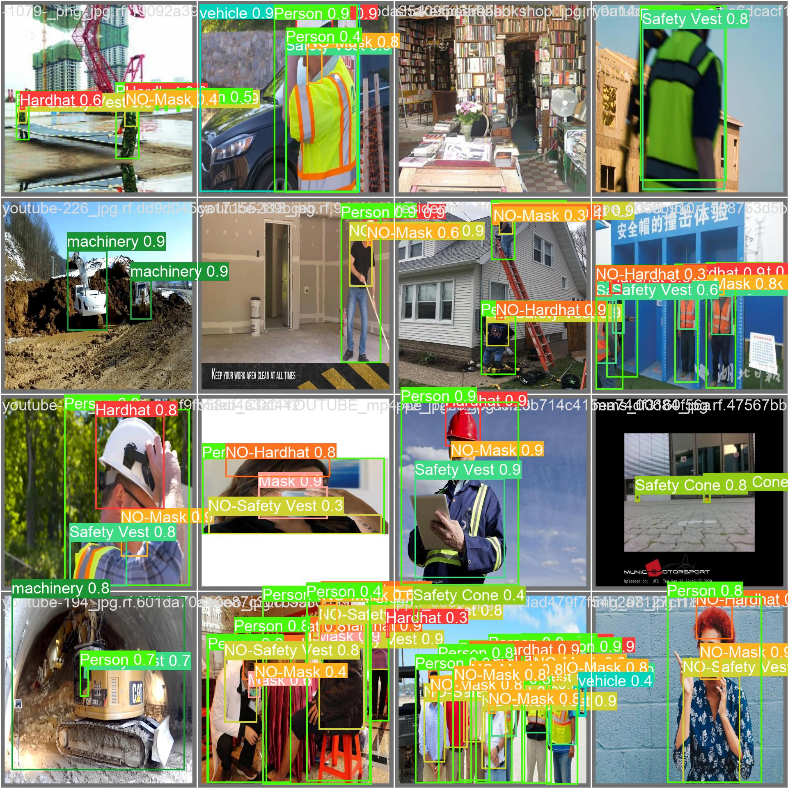

# 🦺 Industrial PPE Safety AI

YOLOv8-based computer vision system that detects missing PPE and unsafe behavior on industrial sites, raises restricted-zone alerts, logs incidents, and scores risk on a live dashboard.

> Built as a team semester project at Vishwakarma Institute of Technology (VIT), Pune.

<!-- Add a demo GIF or screenshot here. -->
<!--  -->

## What it does

- **PPE detection:** detects whether workers are wearing required gear from video or camera feeds
- **Unsafe behavior detection:** flags risky actions and violations
- **Restricted-zone alerts:** triggers an alert when someone enters a defined danger zone
- **Incident reporting:** logs violations with a timestamp
- **Risk-scoring dashboard:** aggregates incidents into a risk score so problem areas are visible at a glance

## How it works

```
Camera / Video  →  YOLOv8 detection  →  Rule checks  →  Incident log  →  Dashboard
                   (detector.py)        (PPE, zones)                      (static/index.html)
```

## Tech stack

`Python` `YOLOv8 (Ultralytics)` `OpenCV` `HTML/JS dashboard`
<!-- edit: add the web framework main.py uses (FastAPI / Flask) -->

## Getting started

```bash
git clone https://github.com/DevChinmaysamal17/industrial-ppe-safety-ai.git
cd industrial-ppe-safety-ai

python -m venv venv
source venv/bin/activate
pip install -r requirements.txt

python main.py
```

The trained PPE model is included at `models/ppe_yolov8.pt`.

## Model training

The detector is a **YOLOv8s** model trained for **80 epochs**. Training outputs (curves, confusion matrices, validation predictions) are in [`results/`](results/).

<!-- Fill in: dataset name + source, and whether you trained it or adapted a public notebook. -->
**Dataset:** _TBD (add name, source link, number of classes)_

<p align="center">
  
  
</p>

<p align="center">
  
</p>

### Metrics

<!-- Real numbers only, from results/runs/detect/yolov8s_ppe_css_80_epochs/results.csv -->
| Metric | Value |
|---|---|
| mAP@0.5 | _TBD_ |
| Precision | _TBD_ |
| Recall | _TBD_ |

## Project structure

```
industrial-ppe-safety-ai/
├── main.py            # app entry point
├── detector.py        # YOLOv8 detection + PPE/zone logic
├── models/
│   └── ppe_yolov8.pt  # trained PPE detection weights
├── static/
│   └── index.html     # dashboard UI
├── results/           # training outputs: curves, confusion matrix, predictions
├── data/              # sample inputs
├── requirements.txt
└── LICENSE
```

## Team

Built by Chinmay Samal and teammates at VIT, Pune.
<!-- Add teammates' names + GitHub links, and say which part you built. -->

## License

MIT